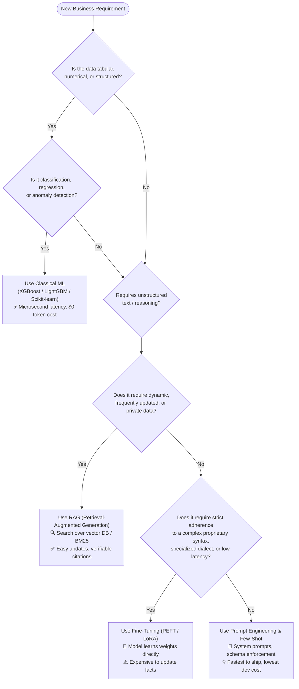

# 🧭 The Architecture Decision Matrix: Prompting vs RAG vs Fine-Tuning vs Classical ML

> **The #1 System Design Trap:** Junior engineers jump straight to training models or spinning up multi-agent swarms for simple problems. Senior AI Engineers evaluate problems through **cost, latency, data freshness, and maintenance overhead**.

---

## 1. The High-Level Decision Flowchart

---

## 2. Comprehensive Trade-off Matrix

| Dimension | Prompt Engineering | RAG (Hybrid Search) | Fine-Tuning (LoRA / QLoRA) | Classical ML (XGBoost) |
| :--- | :---: | :---: | :---: | :---: |
| **Primary Purpose** | Guiding model reasoning & format | Providing external dynamic facts | Teaching style, tone, or new syntax | Predicting numbers/categories from rows |
| **Knowledge Dynamic** | Static (inside prompt) | **Dynamic** (updated instantly in DB) | **Static** (baked into weights) | Static (requires retraining) |
| **Hallucination Risk** | High | **Low** (grounded in passages) | Medium | **Zero** (deterministic output) |
| **Auditability & Citations**| None | **Exact** (source chunk quotes) | Impossible (black box weights) | High (Feature importances, SHAP) |
| **Latency** | 500ms – 2s | 800ms – 3s (retrieval + gen) | **200ms – 800ms** (smaller prompt) | **< 5ms** (microsecond inference) |
| **Cost per 1M Queries** | \$10 – \$50 | \$15 – \$60 | \$2 – \$15 (with smaller model) | **< \$0.01** |
| **Training Hardware** | None (Zero GPUs) | None (Vector DB only) | 1x GPU (A10G or Colab T4) | Standard CPU |

---

## 3. Real-World Architectural Case Studies

### Case A: E-Commerce Product Recommendation
* ❌ **Bad Junior Choice:** Feed user click history into Claude 3.5 Sonnet to pick products. (Cost: thousands of dollars/day; Latency: 2 seconds).
* ✅ **Senior Architect Choice:** Two-tower collaborative filtering or **XGBoost / LightGBM** on tabular user features. (Cost: pennies; Latency: 8 milliseconds).

### Case B: Internal Company HR & Policy Assistant
* ❌ **Bad Junior Choice:** Fine-tune Llama 3 on employee handbooks. (Every time policy changes, you must retrain and re-deploy; model still hallucinates).
* ✅ **Senior Architect Choice:** **Hybrid RAG with BM25 + Qdrant + Cohere Rerank**. (When a policy doc changes, update one chunk in Qdrant; zero GPU retraining required).

### Case C: Medical Scribe (Converting audio transcript to strict FHIR JSON)
* ❌ **Bad Junior Choice:** Pure Prompt Engineering with a 3,000-token prompt defining all medical schemas. (Costs a fortune in prompt tokens, fails schema 5% of the time).
* ✅ **Senior Architect Choice:** **Fine-tune an 8B model (Llama 3 / Mistral) with LoRA** on 2,000 paired transcripts and FHIR JSON outputs. (Model internalizes the schema; prompt can be 1 sentence; 99.8% syntax compliance).

---

## 4. The "RAG vs Fine-Tuning" Rule of Thumb

* **Use RAG when the model needs to *KNOW* something.**  
  *(Facts, documents, internal knowledge, user-specific data).*
* **Use Fine-Tuning when the model needs to *ACT* or *SOUND* like something.**  
  *(Writing in a specific tone, emitting specialized code, obeying strict schemas, or minimizing prompt tokens).*
* **Best-in-class Enterprise Pattern (RAG + Fine-Tuning):**  
  Fine-tune a small 8B model to be an expert RAG answer synthesizer, and feed it retrieved context from a hybrid search index.
